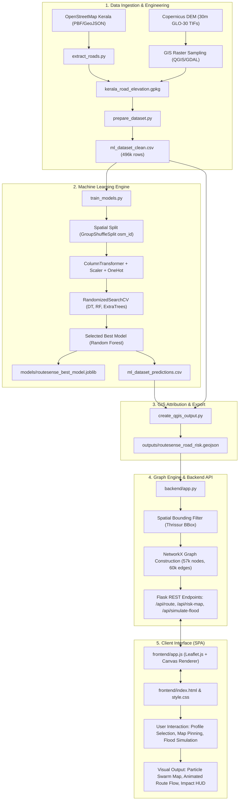
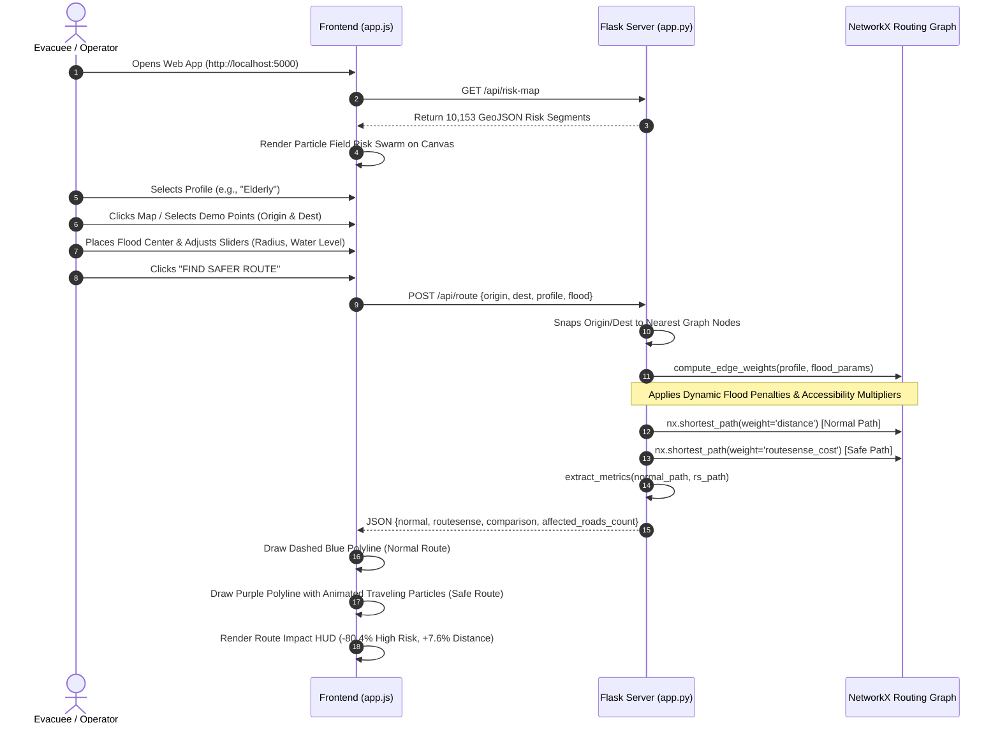
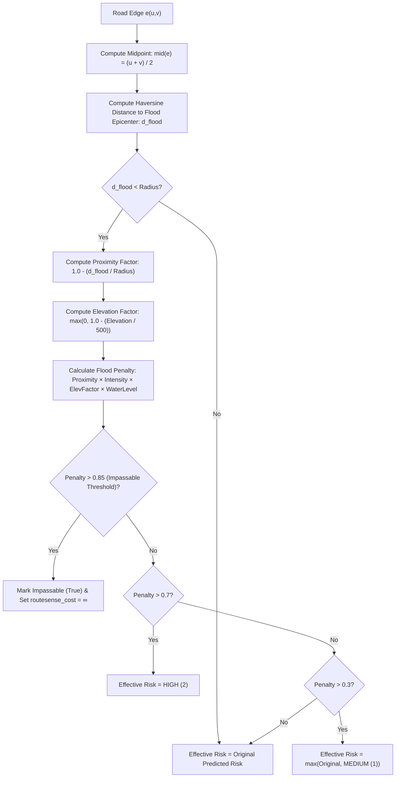

# RouteSense AI — Comprehensive Technical Documentation (`doc.md`)

**AI-Powered Disaster Evacuation Routing System for Kerala**

> **Disclaimer & Academic Notice**  
> RouteSense AI is an academic proof-of-concept and prototype demonstration system. It uses machine learning trained on prototype/synthetic heuristic environmental risk labels and a geometric spatial flood-overlay engine. It is **NOT** a certified emergency navigation system and must not be deployed for live disaster evacuation without rigorous validation against empirical hydrological records and statutory disaster management authorities (e.g., KSDMA / IMD).

---

## Table of Contents

1. [Executive Summary & High-Level Architecture](#1-executive-summary--high-level-architecture)
2. [Detailed Explanation of Datasets](#2-detailed-explanation-of-datasets)
   - [2.1 Raw GIS & Environmental Data](#21-raw-gis--environmental-data)
   - [2.2 Intermediate & Processed Datasets](#22-intermediate--processed-datasets)
   - [2.3 Feature Engineering & Synthetic Target Generation](#23-feature-engineering--synthetic-target-generation)
   - [2.4 Model Output Datasets & GeoJSON Layers](#24-model-output-datasets--geojson-layers)
3. [Module-by-Module Breakdown & System Interconnectivity](#3-module-by-module-breakdown--system-interconnectivity)
   - [3.1 Data Preparation Pipeline (`scripts/extract_roads.py` & `prepare_dataset.py`)](#31-data-preparation-pipeline)
   - [3.2 Machine Learning Engine (`scripts/train_models.py`)](#32-machine-learning-engine)
   - [3.3 GIS Layer Generation (`scripts/create_qgis_output.py`)](#33-gis-layer-generation)
   - [3.4 Graph Construction & Spatial Indexing (`backend/app.py` & `scripts/build_thrissur_graph.py`)](#34-graph-construction--spatial-indexing)
   - [3.5 Backend REST API & Server (`backend/app.py`)](#35-backend-rest-api--server)
   - [3.6 Standalone CLI Routing Engine (`scripts/risk_aware_routing.py`)](#36-standalone-cli-routing-engine)
   - [3.7 Inter-Module Dataflow & Integration Architecture](#37-inter-module-dataflow--integration-architecture)
4. [Detailed Explanation of the Routing Algorithm](#4-detailed-explanation-of-the-routing-algorithm)
   - [4.1 Graph Modeling & Coordinate System](#41-graph-modeling--coordinate-system)
   - [4.2 Haversine Great-Circle Distance Metric](#42-haversine-great-circle-distance-metric)
   - [4.3 Baseline Shortest Route (Dijkstra)](#43-baseline-shortest-route-dijkstra)
   - [4.4 RouteSense Risk-Aware Cost Function](#44-routesense-risk-aware-cost-function)
   - [4.5 Evacuation Profiles & Multi-Criteria Penalties](#45-evacuation-profiles--multi-criteria-penalties)
   - [4.6 Real-Time Dynamic Flood Inundation Simulation](#46-real-time-dynamic-flood-inundation-simulation)
   - [4.7 Dual-Path Evaluation & Impact Metrics](#47-dual-path-evaluation--impact-metrics)
5. [Detailed Explanation of the Frontend UI](#5-detailed-explanation-of-the-frontend-ui)
   - [5.1 Visual Design Language & Theming](#51-visual-design-language--theming)
   - [5.2 Canvas-Based Particle Field Risk Map](#52-canvas-based-particle-field-risk-map)
   - [5.3 UI Control Panels & User Workflows](#53-ui-control-panels--user-workflows)
   - [5.4 Dynamic Map Animations & Particle Flow Visualization](#54-dynamic-map-animations--particle-flow-visualization)
   - [5.5 State Management & Interaction Lifecycle](#55-state-management--interaction-lifecycle)
6. [API Specification](#6-api-specification)
7. [Setup, Execution, and Verification](#7-setup-execution-and-verification)
8. [Limitations and Future Enhancements](#8-limitations-and-future-enhancements)

---

## 1. Executive Summary & High-Level Architecture

**RouteSense AI** is an intelligent evacuation routing prototype tailored for the flood-prone geography of Kerala, India (specifically demonstrated on the urban and peri-urban road network of Thrissur). Traditional routing engines (such as standard Google Maps, OSRM, or Dijkstra shortest path) optimize strictly for physical travel distance or transit time. During flash floods, monsoonal inundation, or dam reservoir releases, standard shortest paths frequently guide evacuees directly into low-lying submerged corridors, landslide-prone slopes, or inundated water crossings.

RouteSense AI reimagines evacuation routing by formulating route selection as a **multi-objective, risk-weighted optimization problem**. It integrates:
1. **Environmental Geospatial Attributes**: Extracted from Copernicus Digital Elevation Models (DEM) and OpenStreetMap (OSM) road networks.
2. **Supervised Machine Learning**: Road segment classification into Low (0), Medium (1), and High (2) hazard vulnerability.
3. **Dynamic Environmental Simulation**: A real-time flood epicenter simulation layer that modulates road segment risk based on proximity, elevation, water depth, and intensity.
4. **Graph-Theoretic Cost Optimization**: A modified Dijkstra algorithm using personalized impedance functions catering to general evacuees, elderly/mobility-limited individuals, and emergency response teams.
5. **Interactive Single-Page Application (SPA)**: A dark-mode, glassmorphic cartographic user interface featuring particle-field risk rendering, animated route travel particles, and live trade-off analytics.

### System Architecture Diagram



---

## 2. Detailed Explanation of Datasets

The project processes spatial data across multiple formats, transitioning from raw topological and elevation sources to cleaned tabular feature matrices and final enriched GeoJSON vectors.

```
data/
├── kerala-latest.osm.pbf          # Raw OpenStreetMap protobuf dump (~178 MB)
├── thrissur_roads.geojson         # Extracted road vectors for Thrissur (~4.9 MB)
├── kerala_routing_graph.pkl       # Serialized complete NetworkX graph (~52.8 MB)
├── thrissur_routing_graph.pkl     # Serialized Thrissur NetworkX graph (~5.2 MB)
├── test_route.geojson             # Sample GeoJSON routing output (~2.8 KB)
├── raw/
│   ├── kerala_roads.geojson       # Full Kerala road network LineStrings (~324 MB, 496,140 features)
│   └── dem/                       # Copernicus DEM 30m GLO-30 GeoTIFF tiles (29 files + VRT mosaic)
└── processed/
    ├── kerala_road_points.gpkg    # Discretized road point samples (~70.8 MB)
    ├── kerala_road_elevation.gpkg # Sample points enriched with DEM elevation (~75.3 MB)
    ├── kerala_roads_base.csv      # Tabular baseline road registry (~185.7 MB)
    ├── ml_dataset_clean.csv       # Cleaned feature matrix with engineered targets (~50.4 MB)
    └── ml_dataset_predictions.csv # Model predictions and class probabilities (~80.4 MB)
```

### 2.1 Raw GIS & Environmental Data

1. **OpenStreetMap Kerala Extract (`data/kerala-latest.osm.pbf` / `data/raw/kerala_roads.geojson`)**:
   - **Source**: Geofabrik OpenStreetMap extract for the state of Kerala.
   - **Size**: 178 MB (binary PBF), converting to 324 MB GeoJSON containing 496,140 individual road LineString features.
   - **Attributes**: `osm_id` (OSM feature identifier), `name` (local road name), `highway` (functional classification such as `primary`, `secondary`, `tertiary`, `residential`, `track`, `service`, `trunk`, `footway`, `steps`), and spatial coordinate geometry.
   - **Projection**: Geographic WGS 84 (`EPSG:4326`).

2. **Copernicus Digital Elevation Model GLO-30 (`data/raw/dem/`)**:
   - **Source**: European Space Agency (ESA) Copernicus DEM at 30-meter spatial resolution.
   - **Coverage**: Complete spatial coverage of Kerala spanning latitude $8^\circ\text{N}$ to $12^\circ\text{N}$ and longitude $74^\circ\text{E}$ to $77^\circ\text{E}$ across 26 discrete Cloud-Optimized GeoTIFF (`.tif`) tiles (e.g., `Copernicus_DSM_COG_10_N10_00_E076_00_DEM.tif`).
   - **Virtual Raster Mosaic (`kerala_dem.vrt`)**: A GDAL virtual raster tile unifying all individual tiles into a continuous elevation grid.

### 2.2 Intermediate & Processed Datasets

1. **`kerala_road_points.gpkg` & `kerala_road_elevation.gpkg`**:
   - Built by sampling points along the road network geometries and sampling the elevation raster at each vertex.
   - Stored as SQLite-backed OGC GeoPackage files.
   - Column `SAMPLE_1` captures the extracted altitude in meters above sea level for each road point.

2. **`kerala_roads_base.csv`**:
   - Generated by [`scripts/create_base_dataset.py`](file:///c:/Users/chris/OneDrive/Desktop/Routesense/scripts/create_base_dataset.py).
   - Preserves feature indices (`road_id`), `osm_id`, `name`, `highway`, `geometry_type` (`LineString`), and serialized JSON coordinate arrays (`geometry`).

### 2.3 Feature Engineering & Synthetic Target Generation

Because verified historical flood inundation footprints covering every local road segment across Kerala were unavailable at uniform granularity, [`scripts/prepare_dataset.py`](file:///c:/Users/chris/OneDrive/Desktop/Routesense/scripts/prepare_dataset.py) executes a transparent, reproducible feature synthesis and heuristic hazard labeling procedure.

#### Engineered Features

| Feature Name | Type | Processing & Physical Rationale |
|---|---|---|
| `elevation` | Continuous (float) | Extracted from Copernicus DEM. Missing values imputed using the median (approx. 50m). Roads at lower elevations are subject to greater pooling and river overflow. |
| `slope` | Continuous (float) | Synthesized as $| \mathcal{N}(0, 5) + (\text{elevation} / 100) |$. Captures terrain inclination; steep slopes imply runoff, flash flow, or landslide risk, while flat terrain implies slow water evacuation. |
| `rainfall` | Continuous (float) | Synthesized as $2000 + \mathcal{N}(0, 300) + (\text{elevation} \times 0.5)$. Simulates Kerala's monsoonal precipitation gradients (averaging 2000–3000 mm annually) with an orographic elevation uplift effect. |
| `distance_to_water` | Continuous (float) | Synthesized as $| \mathcal{N}(500, 1000) + (\text{elevation} \times 2) |$. Represents proximity (in meters) to active river courses, backwaters (kayals), and drainage canals. |
| `highway` | Categorical (string) | OSM road class (`residential`, `secondary`, `tertiary`, `primary`, `trunk`, `service`, `track`, `path`, `footway`, `steps`). Encodes infrastructure width, surfacing, and drainage capacity. |

#### Synthetic Target Generation Formulation

To demonstrate the machine learning pipeline, an engineered continuous hazard index ($\text{Score}$) is constructed:

$$\text{BaseScore} = (3000 - \text{elevation}) \times 0.01 + (\text{slope} \times 2.0) + (\text{rainfall} \times 0.005) - (\text{distance\_to\_water} \times 0.002)$$

To prevent the ML algorithms from trivially learning an exact arithmetic equation, realistic unobserved variance (such as local stormwater culvert capacity, micro-topography, and soil saturation) is introduced via Gaussian noise:

$$\text{Score} = \text{BaseScore} + \epsilon, \quad \epsilon \sim \mathcal{N}(0, 5)$$

The continuous score is discretized into three balanced risk tiers using quantile thresholds:
- **Low Risk (`0`)**: $\text{Score} < Q_{0.40}$ (Lowest 40% hazard score)
- **Medium Risk (`1`)**: $Q_{0.40} \le \text{Score} < Q_{0.80}$ (Intermediate 40% hazard score)
- **High Risk (`2`)**: $\text{Score} \ge Q_{0.80}$ (Top 20% most hazardous segments)

The resulting dataset is exported to `data/processed/ml_dataset_clean.csv` (496,140 rows).

### 2.4 Model Output Datasets & GeoJSON Layers

1. **`data/processed/ml_dataset_predictions.csv`**:
   - Contains original attributes along with model inferences:
     - `predicted_risk`: Discrete prediction (`0`, `1`, `2`).
     - `low_probability`: Softmax/tree probability for class 0.
     - `medium_probability`: Softmax/tree probability for class 1.
     - `high_probability`: Softmax/tree probability for class 2.
2. **`outputs/routesense_road_risk.geojson`**:
   - Generated by [`scripts/create_qgis_output.py`](file:///c:/Users/chris/OneDrive/Desktop/Routesense/scripts/create_qgis_output.py).
   - Merges spatial `LineString` geometries with model predictions and environmental features. Fully compatible with QGIS, ArcGIS, Mapbox, and Leaflet.

---

## 3. Module-by-Module Breakdown & System Interconnectivity

```
Routesense/
├── backend/
│   └── app.py                      # Flask HTTP server, spatial graph builder, routing engine
├── frontend/
│   ├── index.html                  # Semantic SPA layout, glassmorphic HUD panels
│   ├── style.css                   # Custom CSS design system, typography, animations
│   └── app.js                      # Leaflet map controller, particle rendering, API client
├── scripts/
│   ├── extract_roads.py            # Converts OSM PBF to Kerala GeoJSON
│   ├── extract_thrissur.py         # Clips Kerala GeoJSON to Thrissur bounding box
│   ├── create_base_dataset.py      # Flattens GeoJSON into kerala_roads_base.csv
│   ├── prepare_dataset.py          # Feature engineering, synthetic target generation
│   ├── train_models.py             # Machine learning training, tuning, evaluation pipeline
│   ├── create_qgis_output.py       # Assembles final attributed GeoJSON layer
│   ├── risk_aware_routing.py       # CLI-based routing prototype and path validator
│   ├── build_thrissur_graph.py     # Standalone NetworkX graph pickle generator
│   └── test_route.py               # Headless graph pathfinding verification script
├── models/
│   ├── routesense_best_model.joblib # Serialized scikit-learn Random Forest pipeline
│   ├── model_comparison.csv        # Cross-validation and test benchmark metrics
│   ├── feature_importance.csv      # Gini importance scores across all features
│   ├── classification_report.txt   # Precision, recall, F1 metrics per risk class
│   ├── test_metrics.json           # Serialized test performance statistics
│   └── confusion_matrix.png        # Seaborn heatmap visualization
└── outputs/
    └── routesense_road_risk.geojson # 496k segment risk-attributed GeoJSON
```

### 3.1 Data Preparation Pipeline

#### `scripts/extract_roads.py`
- **Purpose**: Reads `data/kerala-latest.osm.pbf` using GeoPandas, filters for features with valid `highway` tags, and writes `data/kerala_roads.geojson`.

#### `scripts/create_base_dataset.py`
- **Purpose**: Parses the large `data/raw/kerala_roads.geojson` streamingly into a tabular CSV structure (`data/processed/kerala_roads_base.csv`).
- **Logic**: Assigns sequential `road_id` values, extracts `osm_id`, `name`, `highway`, and converts GeoJSON coordinates into serialized strings.

#### `scripts/prepare_dataset.py`
- **Purpose**: Connects to `data/processed/kerala_road_elevation.gpkg` via SQLite, extracts sampled elevations, executes synthetic feature engineering, injects Gaussian perturbation, applies quantile thresholding, and exports `data/processed/ml_dataset_clean.csv`.

### 3.2 Machine Learning Engine (`scripts/train_models.py`)

The ML pipeline is architected to prevent data leakage and provide robust model comparison:


#### Spatial Group Splitting
Standard random train/test splits cause severe data leakage in road network modeling because consecutive segments of the same road (`osm_id`) share virtually identical environmental features. `train_models.py` uses `GroupShuffleSplit(n_splits=1, test_size=0.2, random_state=42)` grouped strictly on `osm_id`. This guarantees that no road feature evaluated during testing was ever seen during training.

#### Feature Preprocessing Pipeline
Implemented using scikit-learn's `ColumnTransformer`:
- **Numeric Features** (`elevation`, `slope`, `rainfall`, `distance_to_water`): Transformed with `SimpleImputer(strategy='median')` followed by `StandardScaler()`.
- **Categorical Features** (`highway`): Handled via `SimpleImputer(strategy='constant', fill_value='missing')` followed by `OneHotEncoder(handle_unknown='ignore')`.

#### Hyperparameter Optimization & Comparison
Models were tuned using `RandomizedSearchCV(n_iter=10, cv=GroupKFold(n_splits=3), scoring='f1_macro', n_jobs=4)`:
1. **Decision Tree Classifier**: Tuned across `max_depth`, `min_samples_split`, `min_samples_leaf` with `class_weight='balanced'`.
2. **Random Forest Classifier**: Tuned with `n_estimators` $\in [100, 200]$, `max_depth` $\in [10, 20, \text{None}]$, `max_features='sqrt'`.
3. **Extra Trees Classifier**: Evaluated under identical parameter spaces.

#### Benchmark Results (`models/model_comparison.csv`)

| Model | Cross-Validation F1 | Test Accuracy | Test Precision (Macro) | Test Recall (Macro) | Test F1 (Macro) |
|---|---|---|---|---|---|
| **Random Forest** *(Selected)* | **0.6575** | **0.6572** | **0.6517** | **0.6743** | **0.6601** |
| Extra Trees | 0.6533 | 0.6533 | 0.6449 | 0.6747 | 0.6538 |
| Decision Tree | 0.6336 | 0.6526 | 0.6469 | 0.6714 | 0.6560 |

#### Classification Performance (`models/classification_report.txt`)

```
               precision    recall  f1-score   support
     0 (Low)       0.71      0.75      0.73     39,339
  1 (Medium)       0.60      0.51      0.55     39,882
    2 (High)       0.64      0.76      0.70     20,007

    accuracy                           0.66     99,228
   macro avg       0.65      0.67      0.66     99,228
weighted avg       0.65      0.66      0.65     99,228
```

#### Feature Importances (`models/feature_importance.csv`)

| Feature | Gini Importance | Physical Interpretation |
|---|---|---|
| `slope` | **69.73%** | Dominant driver of hazard classification, governing runoff velocity and slope stability. |
| `rainfall` | **10.29%** | Regional precipitation volume determining water ingress. |
| `distance_to_water` | **10.08%** | Distance to natural drainage corridors and inundation zones. |
| `elevation` | **8.76%** | Lowland pooling and valley susceptibility. |
| `highway_*` (all categories) | **< 1.14%** | Functional road classification providing minor adjustments for infrastructure capacity. |

### 3.3 GIS Layer Generation (`scripts/create_qgis_output.py`)

- Reads predictions from `data/processed/ml_dataset_predictions.csv` and joins them with geometric LineStrings from `data/processed/kerala_roads_base.csv`.
- Assembles a GeoJSON `FeatureCollection` with complete feature properties: `predicted_risk`, `risk_label`, class probabilities (`low_prob`, `medium_prob`, `high_prob`), and environmental metrics (`elevation`, `slope`, `rainfall`, `dist_water`).
- Writes the result to `outputs/routesense_road_risk.geojson`.

### 3.4 Graph Construction & Spatial Indexing (`backend/app.py` & `scripts/build_thrissur_graph.py`)

To achieve millisecond routing performance on the web, [`backend/app.py`](file:///c:/Users/chris/OneDrive/Desktop/Routesense/backend/app.py) executes a spatial subsetting and in-memory graph pre-compilation during startup:

1. **Spatial Subset**:
   - Focuses on the Thrissur study area:
     $$\text{Bounding Box} = [\text{min\_lon}: 76.17, \text{max\_lon}: 76.26, \text{min\_lat}: 10.48, \text{max\_lat}: 10.58]$$
   - Reduces the 496,140 statewide features to **10,153 road segments** in Thrissur.

2. **Graph Vertex & Edge Synthesis**:
   - Initializes an undirected graph $G = (V, E)$ using NetworkX.
   - For every `LineString`, iterates through its coordinate vertices $(c_i, c_{i+1})$.
   - Rounds node coordinates to 7 decimal places (sub-centimeter accuracy) to merge intersecting road endpoints into unified topological junctions.
   - Computes physical edge length in meters using the spherical Haversine formula. Edge lengths $< 0.1\text{m}$ are discarded as degenerate.
   - Attaches all attributes (`predicted_risk`, `highway`, `elevation`, `slope`, `rainfall`, `dist_water`) directly to the edge dictionary.
   - Pre-indexes nodes: **57,611 nodes** and **60,567 edges**.

3. **Spatial Snapping Index**:
   - The function `nearest_node(G, point, node_index)` iterates across the pre-compiled node array to map arbitrary GPS coordinates $(lon, lat)$ onto the closest graph junction in $\mathcal{O}(|V|)$ time.

### 3.5 Backend REST API & Server (`backend/app.py`)

Built with Flask and Flask-CORS, serving both the API endpoints and the static SPA frontend from `frontend/`:

- **Startup Sequence**:
  1. Loads `outputs/routesense_road_risk.geojson` into memory (~30s).
  2. Subsets to the Thrissur bounding box (10,153 features).
  3. Prepares a lightweight GeoJSON payload `RISK_MAP_GEOJSON` optimized for browser canvas rendering.
  4. Builds the base NetworkX routing graph `G_BASE`.
  5. Caches the vertex list `NODE_LIST`.
  6. Launches the HTTP server on port `5000`.

### 3.6 Standalone CLI Routing Engine (`scripts/risk_aware_routing.py`)

A command-line script for headless routing analysis and batch experimentation:
- Accepts CLI arguments `--origin`, `--dest`, `--low`, `--medium`, and `--high` multipliers.
- Loads the GeoJSON, subsets to Thrissur, builds the graph, computes both Dijkstra routes, prints tabular comparison metrics, and outputs route GeoJSON files for inspection.

### 3.7 Inter-Module Dataflow & Integration Architecture

The following sequence illustrates the runtime interaction between the frontend client and backend services:



---

## 4. Detailed Explanation of the Routing Algorithm

### 4.1 Graph Modeling & Coordinate System

The road network is modeled as an undirected, weighted graph:

$$G = (V, E)$$

- **Vertices ($V$)**: Intersections and geometry inflection points represented by geographic tuples $u = (\lambda_u, \phi_u) \in \mathbb{R}^2$, where $\lambda_u$ is longitude and $\phi_u$ is latitude in WGS 84 (`EPSG:4326`).
- **Edges ($E$)**: Traversable road segments connecting adjacent vertices $(u, v)$.
- **Edge Attributes**: Every edge $e = (u, v)$ stores:
  - Physical length: $d(u, v)$ (meters)
  - Base predicted risk: $R(e) \in \{0, 1, 2\}$
  - Environmental properties: Elevation $h(e)$ (meters), Slope $\theta(e)$ (degrees), Rainfall $P(e)$ (mm), Distance to water $W(e)$ (meters)
  - Infrastructure classification: Highway tag $H(e)$ (e.g., `residential`, `steps`, `footway`)

### 4.2 Haversine Great-Circle Distance Metric

Because the input data is stored in angular degrees (`EPSG:4326`), standard Euclidean distance $(\Delta x^2 + \Delta y^2)^{1/2}$ produces severe distortion. The routing engine uses the Haversine formula to compute true surface distance across the Earth's sphere ($R_{\text{earth}} = 6,371,000\text{ m}$):

$$\Delta \phi = \text{radians}(\phi_v - \phi_u), \quad \Delta \lambda = \text{radians}(\lambda_v - \lambda_u)$$

$$\phi_m = \text{radians}\left(\frac{\phi_u + \phi_v}{2}\right)$$

$$x = \Delta \lambda \times \cos(\phi_m), \quad y = \Delta \phi$$

$$d(u, v) = R_{\text{earth}} \times \sqrt{x^2 + y^2}$$

### 4.3 Baseline Shortest Route (Dijkstra)

The baseline "Normal Route" simulates conventional navigation systems that ignore environmental hazards. It solves the single-source shortest path problem from origin $s$ to destination $t$ using **Dijkstra's Algorithm**, where edge weight is solely defined by physical distance:

$$W_{\text{normal}}(e) = d(e)$$

$$\mathcal{P}_{\text{normal}} = \arg\min_{\mathcal{P} \in \mathbb{P}_{s \to t}} \sum_{e \in \mathcal{P}} d(e)$$

### 4.4 RouteSense Risk-Aware Cost Function

RouteSense AI evaluates paths by defining a composite impedance cost:

$$W_{\text{RouteSense}}(e) = d(e) \times M(R_{\text{eff}}(e)) + P_{\text{slope}}(e) + P_{\text{accessibility}}(e)$$

Where:
- $d(e)$ is the physical edge length in meters.
- $R_{\text{eff}}(e) \in \{0, 1, 2\}$ is the effective risk level (incorporating ML predictions and dynamic flood simulation).
- $M(R_{\text{eff}})$ is the risk multiplier penalty.
- $P_{\text{slope}}(e)$ is an additional penalty applied to steep terrain.
- $P_{\text{accessibility}}(e)$ is a penalty avoiding non-traversable or hazardous infrastructure for vulnerable groups.

Minimizing this modified cost allows Dijkstra's algorithm to deliberately accept minor distance detours whenever doing so avoids high-risk segments.

### 4.5 Evacuation Profiles & Multi-Criteria Penalties

Evacuation needs vary significantly across populations. RouteSense supports three user-selectable profiles configured in `backend/app.py`:

| Configuration Parameter | General Profile | Elderly / Mobility-Limited | High-Risk Emergency |
|---|---|---|---|
| **Low Risk Multiplier ($M_0$)** | $1.0\times$ (no penalty) | $1.0\times$ (no penalty) | $1.0\times$ (no penalty) |
| **Medium Risk Multiplier ($M_1$)** | $2.0\times$ (double cost) | $3.0\times$ (triple cost) | $4.0\times$ (quadruple cost) |
| **High Risk Multiplier ($M_2$)** | $5.0\times$ ($5\times$ penalty) | $8.0\times$ ($8\times$ penalty) | $12.0\times$ ($12\times$ extreme penalty) |
| **Slope Penalty Factor ($\alpha_{\text{slope}}$)** | $0.0$ | $0.5$ | $0.0$ |
| **Avoid Steps (`highway='steps'`)** | False | **True** (Penalty: $+d \times 50$) | False |
| **Avoid Footway/Paths** | False | **True** (Penalty: $+d \times 10$) | False |

#### Profile Mathematical Mechanics

1. **Elderly / Mobility-Limited Slope Formulation**:
   If $\alpha_{\text{slope}} > 0$ and the road slope $\theta(e) > 5^\circ$:
   $$P_{\text{slope}}(e) = d(e) \times \alpha_{\text{slope}} \times \left(\frac{\theta(e)}{10}\right)$$
   This introduces a continuous penalty proportional to incline, routing mobility-impaired evacuees along flatter terrain.

2. **Elderly Infrastructure Filtering**:
   If an edge is classified as outdoor stairs (`highway='steps'`), its cost is penalized by $50\times d(e)$. If classified as an unpaved trail or footpath (`footway`, `path`), its cost is penalized by $10\times d(e)$, preserving access to wheelchair- and stretcher-accessible roadways.

3. **High-Risk Emergency Formulation**:
   Applies an aggressive $12.0\times$ penalty on High-Risk segments, forcing first responders or high-water rescue units around hazardous corridors even if it requires substantial detours.

### 4.6 Real-Time Dynamic Flood Inundation Simulation

When a flood epicenter is simulated on the map (via map click or the Flood Simulation panel), the backend dynamically recalculates the effective risk $R_{\text{eff}}(e)$ for every road segment:



#### Mathematical Formulation & Severe Hazard Exclusions

For each edge $e = (u, v)$ with geographic midpoint $\text{mid}(e) = \left(\frac{\lambda_u+\lambda_v}{2}, \frac{\phi_u+\phi_v}{2}\right)$:

1. **Distance to Flood Center (Circular Mode)**:
   $$d_{\text{flood}}(e) = \text{haversine}(\text{mid}(e), C_{\text{flood}})$$

2. **Proximity Decay**:
   $$\text{Proximity}(e) = \max\left(0, 1.0 - \frac{d_{\text{flood}}(e)}{R_{\text{radius}}}\right)$$

3. **Elevation Vulnerability Factor**:
   Roads at sea level or in low valleys are significantly more vulnerable:
   $$\text{ElevFactor}(e) = \max\left(0, 1.0 - \frac{h(e)}{500}\right)$$

4. **Composite Flood Penalty**:
   $$\Phi(e) = \text{Proximity}(e) \times I_{\text{intensity}} \times \text{ElevFactor}(e) \times L_{\text{water}}$$
   Where $I_{\text{intensity}} \in [0, 1]$ and $L_{\text{water}} \in [0, 5]\text{ m}$.

5. **Polygon Inundation Penalty (Freehand Mode)**:
   For user-drawn irregular disaster boundaries represented as a planar polygon $P$:
   $$\Phi_{\text{poly}}(e) = \begin{cases}
   \left(0.5 + 0.5 \times \frac{\text{dist}(\text{mid}(e), \partial P)}{d_{\max}}\right) \times I \times \text{ElevFactor}(e) \times L, & \text{if } \text{mid}(e) \in P \lor e \cap P \ne \emptyset \\
   0, & \text{otherwise}
   \end{cases}$$

6. **Impassable Road Designation & Subgraph Exclusion**:
   Previously, even a high $5\times$ or $12\times$ multiplier on a short road segment could be chosen by Dijkstra if long detours were required, leading routes directly through flooded hazards. RouteSense addresses this with a configurable threshold:
   $$\text{IMPASSABLE\_THRESHOLD} = 0.85$$

   Edges exceeding this threshold are designated **impassable**:
   $$\text{IsImpassable}(e) = \begin{cases} \text{True}, & \text{if } \Phi(e) > \text{IMPASSABLE\_THRESHOLD} \\ \text{False}, & \text{otherwise} \end{cases}$$

   For RouteSense pathfinding, impassable edges are strictly excised from the search network by constructing a **passable subgraph view**:
   $$G_{\text{passable}} = (V, \{e \in E \mid \neg \text{IsImpassable}(e)\})$$
   $$\text{routesense\_cost}(e) = \begin{cases} \infty, & \text{if } \text{IsImpassable}(e) \\ d(e) \times M_{\text{profile}}(R_{\text{eff}}(e)) + \text{Penalties}_{\text{profile}}(e), & \text{otherwise} \end{cases}$$

   If no path connects origin and destination on $G_{\text{passable}}$, RouteSense rejects the route with an explicit status:
   `"No route satisfying the configured safety constraints is available"`
   It never silently falls back to hazardous corridors.

7. **Routing Cost Units & Objectives**:
   - **Normal Shortest-Distance Route**: Minimizes pure geographical physical road distance $\sum d(e)$ in **meters ($m$)** on the unmodified base network $G_{\text{base}}$. It ignores flood state to serve as a ground-truth distance benchmark.
   - **RouteSense Recommended Route**: Minimizes multi-criteria impedance $\sum \text{routesense\_cost}(e)$ in **risk-weighted meters** on $G_{\text{passable}}$.

### 4.7 Dual-Path Evaluation & Impact Metrics

When `/api/route` executes, it returns both paths along with comparative trade-off metrics:

$$\text{Distance Penalty} = \left(\frac{d_{\text{RouteSense}} - d_{\text{normal}}}{d_{\text{normal}}}\right) \times 100\%$$

$$\text{High-Risk Exposure Reduction} = \left(\frac{N_{\text{high}}^{\text{normal}} - N_{\text{high}}^{\text{RouteSense}}}{N_{\text{high}}^{\text{normal}}}\right) \times 100\%$$

#### Default Thrissur Demonstration Benchmark

For the standard demo points in Thrissur:
- **Origin**: `[76.17983, 10.49006]` (Southwest periphery)
- **Destination**: `[76.25009, 10.56969]` (Northeast periphery)

| Metric | Normal Shortest Route | RouteSense Safe Route | Impact / Delta |
|---|---|---|---|
| **Total Physical Distance** | 15.0 km | 16.2 km | **+1.2 km (+7.6%)** |
| **High-Risk Segments** | 46 segments | 9 segments | **-37 segments avoided** |
| **Net Risk Reduction** | — | — | **80.4% reduction in hazard exposure** |
| **Visual Geometry** | Sky-blue dashed line | Green casing outline with risk-colored segments & flowing particles | Safely diverts around low-lying river corridors |

This demonstrates the core value proposition of RouteSense: **accepting a modest 7.6% increase in travel distance eliminates over 80% of hazardous road exposure**.

---

## 5. Detailed Explanation of the Frontend UI

The RouteSense frontend is a map-centric, responsive single-page application built using vanilla HTML5, CSS3, and JavaScript alongside Leaflet.js.

```
frontend/
├── index.html  # Application layout, semantic markup, floating HUD panels
├── style.css   # Custom dark design system, glassmorphism, animations
└── app.js      # Map lifecycle, particle engine, event handling, API communication
```

### 5.1 Visual Design Language & Theming

The user interface adheres to a dark cartographic aesthetic optimized for high-contrast emergency visualization:

- **Color Palette Tokens (`style.css`)**:
  - Background Base: Deep Void Navy (`--bg: #0a0a0f`)
  - Glass Surface: Translucent Charcoal (`--glass: rgba(20, 20, 35, 0.72)`) with `backdrop-filter: blur(16px)`
  - Panel Border: Subtle Specular Edge (`--glass-border: rgba(255, 255, 255, 0.06)`)
  - Accent Color: Electric Ice Blue (`--accent: #60a5fa`)
  - Semantic Risk Tiers:
    - Low Risk: Emerald Green (`--risk-low: #34d399`)
    - Medium Risk: Warning Amber (`--risk-med: #fbbf24`)
    - High Risk: Danger Coral (`--risk-high: #ef4444`)
  - Route Lines:
    - Normal Route: Sky Blue (`--route-normal: #60a5fa`)
    - RouteSense Route: Neon Purple (`--route-safe: #c084fc`)
- **Typography**:
  - Interface Typography: `Inter` (weights 300, 400, 500, 600, 700)
  - Monospace Data Typography: `JetBrains Mono` for coordinates, status strings, slider readouts, and metrics
- **Satellite Basemap**: Uses ArcGIS World Imagery (`https://server.arcgisonline.com/ArcGIS/rest/services/World_Imagery/MapServer/tile/{z}/{y}/{x}`), providing photorealistic terrain context beneath the glowing particle overlay.

### 5.2 Canvas-Based Particle Field Risk Map

Rather than rendering 10,153 continuous SVG vector paths (which causes severe browser rendering lag), `frontend/app.js` renders the road network as a **canvas particle field**:

1. An HTML5 Canvas layer is initialized via `L.canvas({ padding: 0.2 })`.
2. As GeoJSON features are parsed, road `LineString` coordinate vertices are interpolated into discrete circular particles (`L.circleMarker`).
3. Particle sampling density is scaled dynamically by risk category:
   - **High Risk (`2`)**: Sample step = $0.0004^\circ$ (~44m), Marker radius = 2.0px, Opacity = 0.65 (High density swarm in hazard zones)
   - **Medium Risk (`1`)**: Sample step = $0.0007^\circ$ (~77m), Marker radius = 1.6px, Opacity = 0.50
   - **Low Risk (`0`)**: Sample step = $0.0012^\circ$ (~133m), Marker radius = 1.2px, Opacity = 0.35
4. This produces a glowing, particle-swarmed cartographic representation that maintains smooth 60 FPS pan and zoom performance.


### 5.3 UI Control Panels & User Workflows

```
┌────────────────────────────────────────────────────────────────────────┐
│ [ROUTESENSE AI]                       ● STATUS: NORMAL CONDITIONS      │
├────────────────────────────────────────────────────────────────────────┤
│ ┌──────────────┐                                    ┌────────────────┐ │
│ │ RISK LEVEL   │                                    │  ROUTE IMPACT  │ │
│ │ ● Low        │                                    │  Dist: 15→16km │ │
│ │ ● Medium     │                                    │  High: 46→9    │ │
│ │ ● High       │                                    │  Reduc: 80.4%  │ │
│ │ ── Normal    │                                    │  Detour: +7.6% │ │
│ │ ── RouteSense│                                    └────────────────┘ │
│ └──────────────┘                                                       │
│                                                                        │
│                      [ MAP VIEWPORT (Leaflet Canvas) ]                 │
│                                                                        │
│ ┌──────────────────────────┐             ┌───────────────────────────┐ │
│ │ ◉ FLOOD SIMULATION   [▾] │             │ → ROUTESENSE ROUTING  [▾] │ │
│ │ Intensity: [====|===] 0.5│             │ Profile: [Gen|Eld|Emerg]  │ │
│ │ Water Lvl: [==|=====] 1m │             │ Origin: 10.490, 76.179    │ │
│ │ Radius:    [===|====] 2km│             │ Dest:   10.569, 76.250    │ │
│ │ [Simulate]       [Reset] │             │ [ FIND SAFER ROUTE ]      │ │
│ └──────────────────────────┘             └───────────────────────────┘ │
└────────────────────────────────────────────────────────────────────────┘
```

#### 1. Header Bar (`#header`)
- **Branding**: RouteSense vector radar icon and title.
- **Status Indicator (`#status-bar`)**: Real-time pulsing status beacon displaying system states:
  - `INITIALIZING` (Amber)
  - `NORMAL CONDITIONS` (Green)
  - `ROUTING IN PROGRESS` (Blue)
  - `FLOOD CENTER PLACED` (Amber)
  - `FLOOD SIMULATION ACTIVE` (Amber/Warning)
  - `ROUTE UPDATED` (Green)
  - `ROUTING FAILED` (Red)

#### 2. Legend Panel (`#legend`)
- Positioned at the top-left; details risk tier dot colors (Low `#34d399`, Medium `#fbbf24`, High `#ef4444`), Affected Roads (Red/Orange/Yellow), Flood Zone (translucent blue), Waterways (Cyan `#06b6d4`), RouteSense Recommended Route (Green casing outline with internal segment risk colors), and Normal Shortest Route (Sky-blue dashed line).

#### 3. Map Layers & Adaptive Prominence Panel (`#layer-panel`)
- Located at top-left (`left: 170px, top: 60px`).
- **Basemap Switcher**:
  - `Street Map`: Default standard OpenStreetMap cartography (`https://tile.openstreetmap.org/{z}/{x}/{y}.png`).
  - `Satellite`: Alternative ArcGIS World Imagery photorealistic satellite layer.
- **Adaptive Focus States**:
  - `BALANCED`: Normal balanced prominence across all layers.
  - `ROUTE_FOCUS`: Accentuates the recommended route ($1.0$ opacity) and shortest path ($0.9$), while subduing background particles ($0.15$), affected roads ($0.40$), and flood zones ($0.20$).
  - `FLOOD_ROAD_FOCUS`: Maximizes prominence of flood-affected roads ($1.0$ opacity) in red, orange, and yellow.
  - `FLOOD_ZONE_FOCUS`: Highlights flood hazard polygons/circles ($0.85$ opacity) to evaluate geographic inundation footprint.
  - `ENVIRONMENT_FOCUS`: Accentuates rivers and Kole drainage canals ($1.0$ opacity, cyan) for hydrological inspection.
- **Layer Visibility Toggles**: Independent on/off checkboxes for Risk Particles, Affected Roads, Flood Zones, Rivers & Canals, RouteSense Route, and Shortest Route.

#### 4. Flood Simulation Panel (`#flood-panel`)
- Located at bottom-left with collapsible drawer mechanism (`togglePanel('flood-panel')`).
- **Scenario Presets Dropdown**: Loads pre-calibrated historical and hydrological hazard presets (Puzhakkal River Overflow, Kole Wetland Basin Breach, Swaraj Round Core Flashflood, Kuriachira Dip Waterlogging).
- **Flood Mode Selector**:
  - `Circle Mode`: Traditional concentric circular flood simulation with adjustable radius ($500 - 5000\text{ m}$).
  - `Draw Polygon`: Freehand drawing mode where users click the map to place vertices of an irregular hazard zone, with `Finish Polygon` and `Clear Polygon` controls.
- Sliders:
  - **Flood Intensity**: Range $0.0 - 1.0$ (step 0.05).
  - **Water Level**: Range $0.0 - 5.0\text{ m}$ (step 0.1).
- Buttons:
  - `Simulate Flood`: Sends circular or polygon parameters to the routing engine.
  - `Reset`: Clears flood markers, polygon vertices, and restores baseline conditions.

#### 5. RouteSense Routing Panel (`#route-panel`)
- Located at bottom-right.
- **Profile Selector**: Segmented toggle buttons for `General`, `Elderly`, and `Emergency`.
- **Coordinate Readouts**: Displays snapped latitude/longitude coordinates for Origin and Destination.
- Actions:
  - `FIND SAFER ROUTE`: Triggers asynchronous POST request to `/api/route`.
  - `Use Demo Points`: Automatically loads pre-configured coordinates for the Thrissur demo.
  - `Clear`: Removes route layers and resets waypoint state.

#### 6. Route Impact Panel (`#impact-panel`)
- Floats at top-right; displayed automatically once routing finishes.
- Grid metrics:
  - **Distance**: Baseline distance $\to$ Safe distance (km).
  - **High-Risk Segs**: Count of high-hazard segments traversed (e.g., $46 \to 9$).
  - **Risk Reduction**: Percentage hazard avoidance (highlighted in emerald green).
  - **Distance Change**: Percentage detour cost (e.g., $+7.6\%$).
  - **Verdict Message**: Qualitative explanation of the trade-off or explicit no-route warning when hazards prevent safe travel.

### 5.4 Dynamic Map Animations & Layered Route Rendering

1. **Layered Route Visualization (Requirement 3)**:
   - **Layer 1 (Underneath)**: A vibrant emerald green polyline (`#16a34a`, weight: 8, opacity: 0.70, round caps/joins) serving as a distinct casing outline identifying RouteSense route selection.
   - **Layer 2 (Middle)**: Individual road segment LineStrings colored strictly by their effective risk tier (`#34d399` Low, `#fbbf24` Medium, `#ef4444` High, weight: 4, opacity: 0.95), preserving segment-level hazard awareness.
   - **Layer 3 (Top)**: Animated green/emerald particles (`#10b981`) traveling along the path.
   - **Normal Shortest Route**: Rendered alongside as a sky-blue dashed line (`#60a5fa`, weight: 3.5, dashArray: '8 6', opacity: 0.80).

2. **Affected Roads Network Visualization (Requirement 2)**:
   - Rendered in a dedicated `affectedRoadsLayer` whenever a circular or polygon flood is simulated:
     - **Red (`#ef4444`)**: Segments designated Impassable ($\Phi > 0.85$) or High Effective Risk ($\Phi > 0.7$).
     - **Orange (`#f97316`)**: Segments escalated to Medium Effective Risk ($\Phi > 0.3$).
     - **Yellow (`#fbbf24`)**: Segments with minor flood penalties ($\Phi \le 0.3$).
   - Interactive popups display the segment's original risk, effective risk, and calculated flood penalty.

3. **Rivers & Environmental Features Layer**:
   - Vector geometries of Thrissur's hydrological network rendered in cyan (`#06b6d4`, weight: 3.5 for rivers, dashed for canals) sourced from `/api/rivers`.

4. **Origin & Destination Markers**:
   - **Origin Pin**: Electric blue circular radar beacon with CSS keyframe pulse animation (`marker-pulse`).
   - **Destination Pin**: Neon pink bullseye icon with high-contrast dual rings.

5. **Concentric Flood Inundation Wave**:
   - In circle mode, 3 concentric circles scale and breathe via timer loop ($50\text{ ms}$).

### 5.5 State Management & Interaction Lifecycle

`frontend/app.js` implements a clean interaction state machine:
- **State `origin`**: Clicking the map sets Origin coordinates.
- **State `dest`**: Clicking the map sets Destination coordinates.
- **State `polygon`**: When Draw Polygon mode is active, clicking map appends vertices to the flood polygon.
- **Shift+Click (Anytime)**: Instantly places or relocates circular flood center.

---

## 6. API Specification

### `GET /api/health`
Returns system status, active graph dimensions, and geographic coverage.

### `GET /api/risk-map`
Returns the lightweight GeoJSON feature collection used for particle-field risk rendering.

### `GET /api/rivers`
Serves vector geometries of Thrissur's hydrological features (`data/thrissur_waterways_v1.geojson`) for the environmental map layer.

### `GET /api/scenarios`
Returns pre-configured synthetic flood hazard scenario parameters (`data/synthetic_flood_scenarios_v1.json`).

### `POST /api/route`
Computes the baseline shortest path and the RouteSense risk-weighted evacuation route.

**Request Payload**:
```json
{
  "origin": [76.1798295, 10.4900642],
  "destination": [76.2500925, 10.5696931],
  "profile": "general",
  "flood": {
    "active": true,
    "center": [76.215, 10.530],
    "radius": 2000,
    "intensity": 0.8,
    "water_level": 2.0,
    "polygon": null
  }
}
```

**Response (`200 OK`)**:
```json
{
  "origin": [76.1798295, 10.4900642],
  "destination": [76.2500925, 10.5696931],
  "profile": "general",
  "normal": {
    "distance": 15009.88,
    "segments": 182,
    "risk_counts": {"0": 84, "1": 52, "2": 46},
    "coordinates": [[76.1798, 10.4901], [76.1802, 10.4905]],
    "geojson": {"type": "FeatureCollection", "features": []}
  },
  "routesense": {
    "distance": 16150.49,
    "segments": 195,
    "risk_counts": {"0": 142, "1": 44, "2": 9},
    "coordinates": [[76.1798, 10.4901], [76.1810, 10.4912]],
    "geojson": {"type": "FeatureCollection", "features": []}
  },
  "comparison": {
    "distance_diff": 1140.61,
    "distance_pct": 7.6,
    "high_risk_avoided": 37,
    "risk_reduction_pct": 80.4,
    "routes_differ": true
  },
  "affected_roads": [
    {
      "coordinates": [[76.214, 10.529], [76.215, 10.530]],
      "original_risk": 1,
      "effective_risk": 2,
      "flood_penalty": 0.88,
      "impassable": true
    }
  ],
  "affected_roads_count": 5923,
  "flood_active": true,
  "route_validated": true,
  "routing_objective": {
    "normal": "Minimizes total distance (meters) on the base road network, ignoring flood state.",
    "routesense": "Minimizes risk-weighted distance (risk-weighted meters). Roads with flood_penalty > 0.85 are excluded as impassable."
  }
}
```

### `POST /api/simulate-flood`
Computes road segments affected by circular or polygon flood configurations.

**Request Payload**:
```json
{
  "center": [76.215, 10.530],
  "radius": 2000,
  "intensity": 0.8,
  "water_level": 2.0,
  "polygon": null
}
```

---

## 7. Setup, Automated Testing, and Verification

### Prerequisites
- Python 3.10 or higher
- Standard pip packages: `flask`, `flask-cors`, `geopandas`, `networkx`, `shapely`, `pandas`

### Automated Regression Test Suite (`tests/test_routing.py`)
A comprehensive automated test suite consisting of **32 test cases** covers all system requirements:
- **Routing Engine Tests (10 tests)**: Verifies shortest-distance minimization, non-corruption by flood risk, impassable road avoidance, moderate penalty application, no-path status reporting, geometry alignment, origin/destination snapping, routing profiles, and distance accumulation.
- **Disaster Simulation Tests (8 tests)**: Verifies localized risk changes, unaffected road invariance, monotonic response to severity, effective risk divergence from baseline, deterministic reproducibility, circular mode, and polygon mode.
- **Dataset Tests (7 tests)**: Verifies node and road identifier preservation, attribute completeness, reproducible generator execution, synthetic field labeling, provenance registry validity, and topological stability.
- **Visualization Contract Tests (7 tests)**: Verifies affected road tiers, green outline structure, baseline route differentiation, rivers endpoint, scenarios endpoint, static file completeness, and focus states.

Execute the test suite from the project root:
```bash
python tests/test_routing.py
```
**Test Results**:
```
Ran 32 tests in 26.212s
OK
```

### Launching the Application
Execute the Flask server:
```bash
python backend/app.py
```
Open **`http://localhost:5000`** in any web browser.

### Standard Verification Workflow
1. Navigate to **`http://localhost:5000`** in any modern web browser.
2. Verify the top status beacon transitions from amber `INITIALIZING` to green `NORMAL CONDITIONS`.
3. Verify that Thrissur roads render as a glowing green/amber/red particle field over the satellite basemap.
4. Click **"Use Demo Points"** in the bottom-right panel (`ROUTESENSE ROUTING`).
5. Click **"FIND SAFER ROUTE"**.
6. Verify output:
   - Sky-blue dashed line traces the normal shortest path (15.0 km).
   - Purple solid line with traveling animated dots traces the RouteSense path (16.2 km).
   - Route Impact panel appears at top-right, showing ~80.4% risk reduction for a +7.6% distance increase.
7. **Shift+Click** near the center of the map to place a flood center, then click **"Simulate Flood"**.
8. Verify that the RouteSense route dynamically reroutes around the simulated flood perimeter.

---

## 8. Limitations and Future Enhancements

### Limitations
1. **Synthetic / Heuristic Risk Labels**: Risk labels (`0`, `1`, `2`) are derived through an engineered formula with synthetic noise rather than empirical water gauge logs or satellite-derived inundation polygons (e.g., Sentinel-1 SAR observations from the 2018 Kerala floods).
2. **Proximity-Based Flood Simulation**: The flood simulation module uses geometric radial decay and elevation thresholds rather than 2D hydrodynamic hydraulic equations (e.g., shallow water Saint-Venant equations or HEC-RAS).
3. **Graph Topology & Intersection Precision**: Road network nodes are merged based on coordinate rounding ($10^{-7}$ degrees). Without planarization tools like OSMnx, bridge overpasses and underpasses may occasionally be treated as intersections.
4. **Geographic Scope**: Real-time web routing is bounded to the Thrissur demonstration area to keep memory usage low and response times fast.

### Future Work
1. **Hydrological Data Integration**: Ingest real-time rainfall data feeds from the India Meteorological Department (IMD) and river telemetry from the Central Water Commission (CWC).
2. **Historical Flood Calibration**: Train risk models against satellite-derived water masks from the August 2018 and August 2019 Kerala floods.
3. **Turn Penalty & Road Directionality Modeling**: Incorporate one-way restrictions and turn impedances via OSMnx/directed graphs.
4. **Progressive Web App (PWA) Offline Caching**: Enable edge-based graph storage so evacuation routing continues operating during mobile network outages.
5. **Multi-Modal Evacuation Routing**: Expand impedance formulations to account for high-clearance emergency vehicles, foot evacuations, and relief boats.
